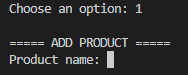
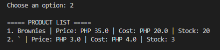
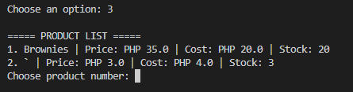
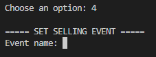
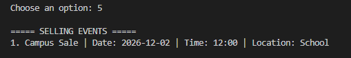
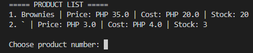
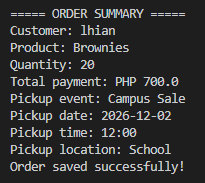
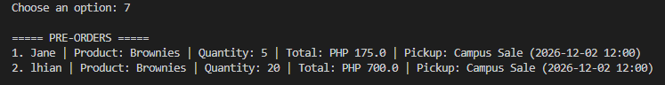
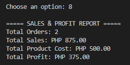
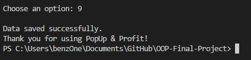

<div align="center">

# PopUp & Profit

###  The Campus Micro-Enterprise & Pre-Order Hub

**IT - 2111** 

</div>

---

## ┊ Project Description
PopUp & Profit is a Java-based Object-Oriented Programming (OOP) console application designed to streamline event-based product sales, customer orders, and profit tracking. By organizing core operations into dedicated `Event`, `Product`, `Order`, and `Profit` classes with persistent `.txt` file storage (`events.txt`, `products.txt`, and `orders.txt`), users can efficiently create events, manage product inventories, process customer orders, and automatically compute net earnings across sessions.

### Problem Being Addressed
Small-scale event vendors, campus pop-ups, and student micro-businesses often rely on manual pen-and-paper logs or scattered spreadsheets to record events, track available products, compute order totals, and calculate overall profit. This manual workflow frequently leads to calculation errors, lost order records, poor inventory visibility, and difficulty determining net earnings after an event concludes.

### Target Users
Designed for student sellers and small campus entrepreneurs managing product inventory, selling event schedules, customer pre-orders, and basic sales/profit tracking.


### Project Objectives
1. Analyze manual pop-up selling workflows and design a modular object-oriented Java solution structured around cohesive classes (`Main`, `Event`, `Product`, `Order`, and `Profit`).
2. Implement core event, product, order, and profit management features supported by input validation, exception handling, and persistent `.txt` file storage.
3. Apply core OOP principles—including encapsulation, abstraction, inheritance, and polymorphism—effectively across the system architecture.

---

## ┊ Main Features
*  **Product & Inventory Management** — Add, view, and restock products with automatic stock updates saved to `products.txt`
*  **Selling Event Scheduling** — Create and view pop-up selling events with date, time, and location details
*  **Pre-Order & Profit Tracking** — Place and view pre-orders tied to pickup events, deduct stock, save to `orders.txt`, and view sales and profit reports
*  **Input Validation & Exception Handling** — `Main.java` validates user inputs via `while` loops, `try-catch` blocks (`NumberFormatException` in `readInt` and `readDouble`, plus `Exception` in `readDate` and `readTime`), minimum value checks, non-empty and no-`|` text checks (`readText`), `LocalDate`/`LocalTime` parsing, and stock/selection checks in `placeOrderMenu` and `restockMenu`; `Event.java`, `Product.java`, and `Order.java` handle bounds checking (`getEvent`, `getProduct`), file existence checks, delimiter line-length checks, and `try-catch` blocks during file saving/loading, while `Profit.java` aggregates stored `Order` records directly without extra file I/O

## ┊ Technologies Used
* **Language:** Java (JDK 8 or later)
* **Data Structures:** `ArrayList` (`ArrayList<Event>`, `ArrayList<Product>`, `ArrayList<Order>`) and `String[]` arrays (for `|`-delimited file parsing)
* **Documentation & Modeling:** UML Class Diagram
* **Version Control:** Git & GitHub

---

##  ┊ Repository & Project Structure

```text
📂 [Project-Name]/
├── 📂 src/
│   ├── Main.java
│   ├── [Class1].java
│   ├── [Class2].java
│   └── ...
├── 📂 docs/
│   ├── Project-Proposal.pdf
│   └── UML-Diagram.png
├── 📂 screenshots/
│   ├── main-menu.png
│   └── sample-output.png
└── README.md
```

* **`Main.java`** — [Entry point of the program that initializes the system and handles the main loop.]
* **`[Class1].java`** — [Brief description of this class's role in the system.]
* **`[Class2].java`** — [Brief description of this class's role in the system.]

---

## ┊ OOP Concepts Demonstrated

### 1. Encapsulation
None of the project classes (`Event`, `Product`, `Order`, `Main`, or `Profit`) currently declare `private` instance fields or `public` getter/setter methods. Instead, fields in `Event` (`name`, `date`, `time`, `location`), `Product` (`name`, `price`, `cost`, `stock`), and `Order` (`customer`, `productName`, `quantity`, `total`, `cost`, `eventName`, `eventDate`, `eventTime`, `eventLocation`) use default (package-private) access, are initialized via `public` constructors, and are read or updated directly across classes (such as `product.stock`, `o.total`, and `e.name`)

```java
// Actual fields and constructor from Product.java (default package-private access; no private fields or getters/setters yet)
String name;
double price;
double cost;
int stock;

public Product(String name, double price, double cost, int stock) {
    this.name = name;
    this.price = price;
    this.cost = cost;
    this.stock = stock;
}
```

### 2. Inheritance
There are currently no parent-child class relationships (`extends`) or subclasses in **PopUp & Profit Hub**; `Main`, `Event`, `Product`, `Order`, and `Profit` are standalone classes and do not reuse shared attributes or methods through subclass inheritance. Instead, classes interact directly (such as `Order` receiving an `Event` and `Product` during order creation, and `Profit` reading `Order.orders`).

```java
// Actual codebase: Inheritance (extends) is not yet implemented.
// Main, Event, Product, Order, and Profit are standalone classes without a parent/child hierarchy.
public class Event {
    String name;
    String date;
    String time;
    String location;
}
```

---

### 3. Polymorphism
Method overriding, dynamic method dispatch, and interface-based implementations are not currently used in **PopUp & Profit Hub** because the project classes (`Main`, `Event`, `Product`, `Order`, and `Profit`) do not use inheritance or interfaces, and rely on direct `static` and instance method calls instead.

```java
// Actual codebase: No method overriding, dynamic method dispatch, or interfaces are implemented.
// Calls are made directly on classes and instances, such as in Profit.java:
public static double getProfit() {
    return getTotalSales() - getTotalCost();
}
```

### 4. Abstraction
`PopUp & Profit Hub` does not currently use `abstract` classes or `interface`s. Instead, behavioral abstraction is handled through concrete class methods that group multi-step operations behind a single method call—such as `Order.placeOrder(...)` handling stock deduction, saving `products.txt` and `orders.txt`, and printing the order summary, or `Profit.viewReport()` calculating and displaying sales, cost, and profit totals.

```java
// Actual codebase: No abstract classes or interfaces are defined.
// Multi-step logic is grouped inside concrete methods, such as in Profit.java:
public static void viewReport() {
    System.out.println("\n===== SALES & PROFIT REPORT =====");
    System.out.println("Total Orders: " + Order.orders.size());
    System.out.printf("Total Sales: PHP %.2f%n", getTotalSales());
    System.out.printf("Total Product Cost: PHP %.2f%n", getTotalCost());
    System.out.printf("Total Profit: PHP %.2f%n", getProfit());
}
```

---

## ┊ Instructions for Running the Program

### Requirements

- Java Development Kit (JDK) 11 or higher (the code uses `FileReader` and `PrintWriter` constructors that accept a charset, which were added in Java 11)

### Using the command line

1. Clone or download this repository.
2. Open a terminal in the project folder.
3. Compile all source files:
   ```bash
   javac *.java
   ```
4. Run the program:
   ```bash
   java Main
   ```

### Using an IDE

1. Open the project folder in your IDE.
2. Make sure `Main.java`, `Product.java`, `Event.java`, `Order.java`, and `Profit.java` are in the same source folder.
3. Run `Main.java`.

### Basic usage flow

1. Choose **1** to add your products.
2. Choose **2** to view your products and check their prices, costs, and stock.
3. Choose **3** to restock a product when its stock runs low.
4. Choose **4** to schedule at least one selling event (required before orders can be placed).
5. Choose **5** to view your scheduled selling events.
6. Choose **6** to place customer pre-orders.
7. Choose **7** to view all pre-orders and their pickup details.
8. Choose **8** to view sales and profit.
9. Choose **9** to exit.
---

### ┊ Sample Screenshots

### Main Menu

*Welcome message and the 9-option main menu.*

### 1. Add Product

*Entering the product name, selling price, cost, and initial stock.*

### 2. View Products

*Product list showing price, cost, and current stock.*

### 3. Restock Product

*Choosing a product, entering the quantity to add, and seeing the new stock.*

### 4. Set Selling Event

*Entering the event name, date, time, and location.*

### 5. View Selling Events

*List of scheduled events.*

### 6. Place Pre-order

*Choosing a product, entering the customer name and quantity, and selecting a pickup event.*


*Order summary with total payment and pickup details.*

### 7. View Pre-orders

*List of all pre-orders with customer, product, quantity, total, and pickup schedule.*

### 8. View Sales & Profit

*Total orders, total sales, total product cost, and total profit.*

### 9. Exit

*Exit message after choosing option 9.*

### Input Validation and Error Messages

*Invalid number, empty text, or the `|` character being rejected.*


*Wrong date format (`YYYY-MM-DD`) and wrong time format (`HH:MM`).*


*"This product is out of stock" and "Not enough stock available" messages.*


*"Please add products first" and "Please schedule a selling event first" messages.*

---

## ┊ Known Limitations

- Console-only interface; there is no graphical user interface.
- Products, events, and orders cannot be edited or deleted once created.
- Orders cannot be cancelled, so stock cannot be returned after an order is placed.
- Orders have no status (pending, paid, picked up), so the profit report counts every pre-order as a completed sale.
- Orders store a copy of the product name, cost, and event details at the time of ordering, so they are not linked to the original product or event objects.
- The `|` character cannot be used in text fields because it separates fields in the data files.
- Lines in the data files that do not have the expected number of fields are skipped when loading.
- Dates are validated for format only; past dates are still accepted.
- Duplicate product names and duplicate events are allowed.
- Money is stored as `double`, so prices may occasionally show floating-point artifacts (e.g., `PHP 49.99999`) in lists.
- Single-user only, with no login or multi-user support.
- Data is stored in local text files rather than a database.


## ┊ Future Improvements

- Add edit and delete functions for products, events, and orders.
- Add order status tracking (pending, paid, picked up, cancelled) and restore stock on cancellation.
- Count only paid or picked-up orders in the profit report.
- Add search and filter options for products and orders.
- Add low-stock alerts.
- Prevent past dates and duplicate entries.
- Use `BigDecimal` for accurate money handling.
- Export reports to CSV or PDF.
- Build a graphical user interface (JavaFX or Swing).
- Move storage to a database such as SQLite.
- Add inheritance or interfaces (for example, different product types) to make the design more extensible.


## ┊ Team Members, Roles & Project Contributors

<table>
  <tr>
    <th>Photo</th>
    <th>Name & GitHub</th>
    <th>Role & Contributions</th>
  </tr>
  <tr>
    <td></td>
    <td><b>Martina Mykaela Myles Delute</b><br><a href="https://github.com/MiKakaela">@MiKakaela</a></td>
    <td><b>Lead Programmer</b><br>• [Contribution 1]<br>• [Contribution 2]</td>
  </tr>
  <tr>
    <td></td>
    <td><b>Princess Leia R. Geneta</b><br><a href="https://github.com/princessgeneta">@princessgeneta</a></td>
    <td><b>Documentation</b><br>• [Contribution 1]<br>• [Contribution 2]</td>
  </tr>
  <tr>
    <td></td>
    <td><b>Lhian Roi B. Magadia</b><br><a href="https://github.com/lhianmagadia">@lhianmagadia</a></td>
    <td><b>Design Programmer</b><br>• [Contribution 1]<br>• [Contribution 2]</td>
  </tr>
  <tr>
    <td></td>
    <td><b>Jane Loraine E. Rosales</b><br><a href="https://github.com/janerosales07">@janerosales07</a></td>
    <td><b>Team Leader</b><br>• [Contribution 1]<br>• [Contribution 2]</td>
  </tr>
</table>
