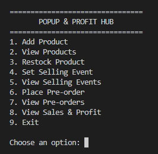

<div align="center">

# PopUp & Profit

###  The Campus Micro-Enterprise & Pre-Order Hub

**IT - 2111** 

*Martina Myles Micaella Delute*  
*Princess Leiah Geneta*  
*Lhian Roi Magadia*  
*Jane Loraine Rosales*

</div>

---

## ┊ Project Description
PopUp & Profit is a Java-based Object-Oriented Programming (OOP) console application designed to streamline event-based product sales, customer orders, and profit tracking. By organizing core operations into dedicated `Event`, `Product`, `Order`, and `Profit` classes with persistent `.txt` file storage (`events.txt`, `products.txt`, and `orders.txt`), users can efficiently create events, manage product inventories, process customer orders, and automatically compute net earnings across sessions.

### Problem Being Addressed
Small-scale event vendors, campus pop-ups, and student micro-businesses often rely on manual pen-and-paper logs or scattered spreadsheets to record events, track available products, compute order totals, and calculate overall profit. This manual workflow frequently leads to calculation errors, lost order records, poor inventory visibility, and difficulty determining net earnings after an event concludes.

### Target Users
[state here]


### Project Objectives
1. Analyze manual pop-up selling workflows and design a modular object-oriented Java solution structured around cohesive classes (`Main`, `Event`, `Product`, `Order`, and `Profit`).
2. Implement core event, product, order, and profit management features supported by input validation, exception handling, and persistent `.txt` file storage.
3. Apply core OOP principles—including encapsulation, abstraction, inheritance, and polymorphism—effectively across the system architecture.

---

## ┊ Project Description
[Write a clear summary of your Java application—what it does, how users interact with it, and what makes it useful.]

### Problem Being Addressed
[Explain the specific real-world or practical problem your application solves.]

### Target Users
* **[User Group 1]:** [How they benefit from using this application]
* **[User Group 2]:** [How they benefit from using this application]

### Project Objectives
1. [Objective 1 — e.g., Analyze a problem and design an object-oriented Java solution.]
2. [Objective 2 — e.g., Implement core features with input validation and exception handling.]
3. [Objective 3 — e.g., Apply encapsulation, inheritance, polymorphism, and abstraction effectively.]

---

## ┊ Main Features
* 🔹 **[Feature 1 Name]** — [Short description of what this feature does]
* 🔹 **[Feature 2 Name]** — [Short description of what this feature does]
* 🔹 **[Feature 3 Name]** — [Short description of what this feature does]
* 🔹 **Input Validation & Exception Handling** — [Describe how invalid user inputs and errors are handled]

## ┊ Technologies Used
* **Language:** Java (JDK 8 or later)
* **Data Structures:** [e.g., Arrays / ArrayLists / HashMaps]
* **Documentation & Modeling:** Markdown, UML Class Diagram
* **Version Control:** Git & GitHub

---

##  ┊ Repository & Project Structure

```text
📂 [Project-Name]/
├── 📂 src/
│   ├── Main.java
│   ├── [Class1].java
│   ├── [Class2].java
│   └── ...
├── 📂 docs/
│   ├── Project-Proposal.pdf
│   └── UML-Diagram.png
├── 📂 screenshots/
│   ├── main-menu.png
│   └── sample-output.png
└── README.md
```

* **`Main.java`** — [Entry point of the program that initializes the system and handles the main loop.]
* **`[Class1].java`** — [Brief description of this class's role in the system.]
* **`[Class2].java`** — [Brief description of this class's role in the system.]

---

## ┊ OOP Concepts Demonstrated

### 1. Encapsulation
[Explain which classes use `private` fields, constructors, and `public` getters/setters to protect and control access to object data.]

```java
// Replace with a real snippet from your project
private String [fieldName];

public String get[FieldName]() {
    return [fieldName];
}

public void set[FieldName](String [fieldName]) {
    this.[fieldName] = [fieldName];
}
```

### 2. Inheritance
[Explain your parent-child class relationships and which shared attributes or methods are reused by subclasses.]

```java
// Replace with a real snippet from your project
public class [ParentClass] {
    protected String [sharedAttribute];
}

public class [ChildClass] extends [ParentClass] {
    // Inherits sharedAttribute and adds specialized behavior
}
```

### 3. Polymorphism
[Explain how your program uses method overriding, dynamic method dispatch, or interface-based implementations.]

```java
// Replace with a real snippet from your project
[ParentClass] obj = new [ChildClass]();
obj.[overriddenMethod]();
```

### 4. Abstraction
[Explain how abstract classes and/or interfaces represent common behavior and hide implementation details.]

```java
// Replace with a real snippet from your project
public abstract class [AbstractClassName] {
    public abstract void [abstractMethod]();
}
```

---

## ┊ Instructions for Running the Program

### Prerequisites
* Java Development Kit (**JDK 8** or later) installed on your machine.

### Steps to Compile & Run
1. Clone this repository:
   ```bash
   git clone [https://github.com/](https://github.com/)[your-username]/[your-repo-name].git
   ```
2. Open your terminal and navigate to the `src` folder:
   ```bash
   cd [your-repo-name]/src
   ```
3. Compile all Java files:
   ```bash
   javac *.java
   ```
4. Run the application:
   ```bash
   java Main
   ```

---

### ┊ Sample Screenshots

### Main Menu


### Sample Output
```text
╔═══════════════════════════════════════╗
║ ▓▓▓         [PROJECT TITLE]       ▓▓▓ ║
╚═══════════════════════════════════════╝
[1] [Menu Option 1]
[2] [Menu Option 2]
[3] Exit

Enter your choice:
```
*(Note: Replace the ASCII box above with a screenshot `` or paste your actual console output here.)*

---

## ┊ Known Limitations
* [Limitation 1 — e.g., Program data is stored in memory and resets when the application closes.]
* [Limitation 2 — e.g., Runs strictly via a command-line interface (CLI).]

## ┊ Future Improvements
* [Improvement 1 — e.g., Add file handling or database persistence to save records permanently.]
* [Improvement 2 — e.g., Develop a graphical user interface (GUI) using JavaFX or Swing.]
* [Improvement 3 — e.g., Add user authentication and role-based access.]

---

## ┊ Team Members, Roles & Project Contributors

<table>
  <tr>
    <th>Photo</th>
    <th>Name & GitHub</th>
    <th>Role & Contributions</th>
  </tr>
  <tr>
    <td></td>
    <td><b>[Member 1 Full Name]</b><br><a href="https://github.com/[USERNAME1]">@[USERNAME1]</a></td>
    <td><b>[Role — e.g., Project Leader / Lead Programmer]</b><br>• [Contribution 1]<br>• [Contribution 2]</td>
  </tr>
  <tr>
    <td></td>
    <td><b>[Member 2 Full Name]</b><br><a href="https://github.com/[USERNAME2]">@[USERNAME2]</a></td>
    <td><b>[Role — e.g., Backend Developer]</b><br>• [Contribution 1]<br>• [Contribution 2]</td>
  </tr>
  <tr>
    <td></td>
    <td><b>[Member 3 Full Name]</b><br><a href="https://github.com/[USERNAME3]">@[USERNAME3]</a></td>
    <td><b>[Role — e.g., QA & Documentation Specialist]</b><br>• [Contribution 1]<br>• [Contribution 2]</td>
  </tr>
</table>
